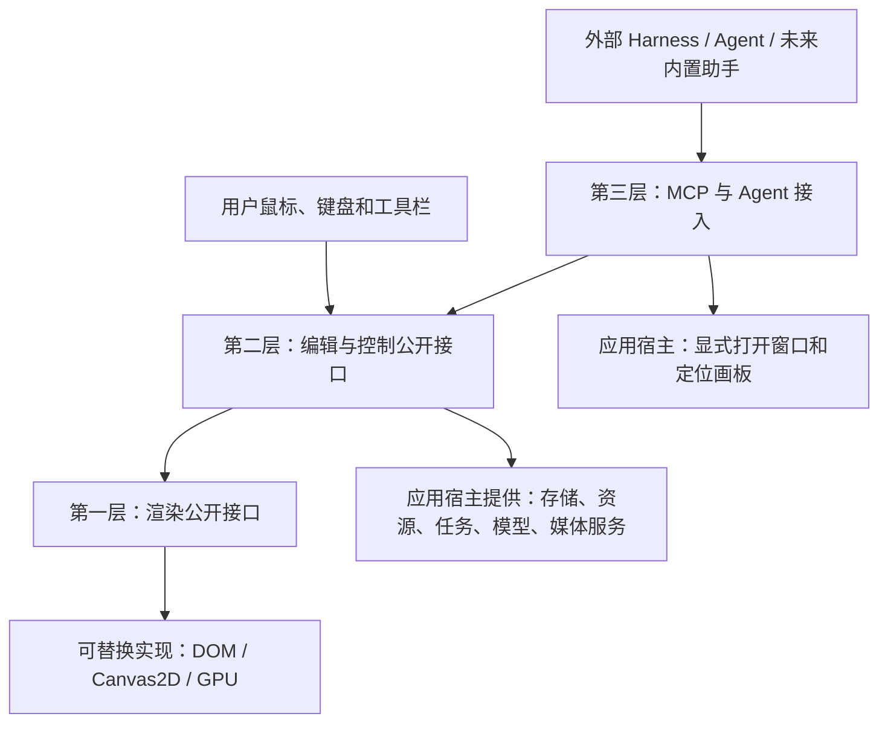
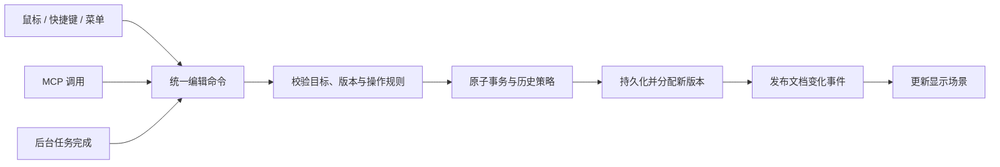

# hiCanvas 三层架构说明

> 状态：架构方向与迁移要求，尚未实施新内核。
>
> 编写日期：2026-11-25。现状核对基线：hiCanvas `761faa5`（应用版本 `0.0.16`），已导入的 Cowart 基线 `38bdafeff47374ddbc11b12bddbc4f1f4cf14587`，当前锁定安装的 tldraw `5.1.1`。依赖声明允许的版本范围不等于验收版本；施工时以锁文件和实际构建为准重新固定基线。
>
> **不可削减的要求：保留当前 hiCanvas 开发成果、tldraw 的全部功能和 Cowart 的全部功能。分阶段是施工顺序，不是减少最终交付范围；没有完成全量功能核对和验收，不切换用户的正式应用。**

## 阅读导航

1. [目标、结论与状态](#1-目标结论与状态)
2. [全部功能保留的范围与核对方式](#2-全部功能保留的范围与核对方式)
3. [三层结构与依赖方向](#3-三层结构与依赖方向)
4. [第一层：无限画布渲染](#4-第一层无限画布渲染)
5. [第二层：编辑、交互与控制](#5-第二层编辑交互与控制)
6. [第三层：MCP 与 Agent 接入](#6-第三层mcp-与-agent-接入)
7. [独立的数据、资源与接口契约](#7-独立的数据资源与接口契约)
8. [批量生成、改图与复合内容的完整流程](#8-批量生成改图与复合内容的完整流程)
9. [技术替换的条件与限制](#9-技术替换的条件与限制)
10. [gpucanvas、Konva 与 tldraw 的位置](#10-gpucanvaskonva-与-tldraw-的位置)
11. [模块划分与独立复用](#11-模块划分与独立复用)
12. [从当前代码迁移的步骤](#12-从当前代码迁移的步骤)
13. [验收、性能和切换门槛](#13-验收性能和切换门槛)
14. [尚待决定的事项与施工入口](#14-尚待决定的事项与施工入口)
15. [来源与维护规则](#15-来源与维护规则)
16. [本机目录关系与资料迁移交接](#16-本机目录关系与资料迁移交接)

## 1. 目标、结论与状态

### 1.1 用户最终得到什么

hiCanvas 是可以手动操作、也可以交给 AI 操作的独立画板。用户在同一块无限画布中放置和编辑图片、文字、形状、HTML、影片及幻灯片；外部 Agent 通过 MCP 使用相同能力。图片模型由用户自行添加，服务地址和模型不写死。以后增加内置文本助手时，也复用同一套画板控制能力。

架构的额外目标是可复用：另一个项目只需要快速展示大量内容，就取第一层；需要完整的画板编辑器，就取前两层；需要外部 Agent 操作，再接第三层。第一层出现更好的渲染方案时，通过替换实现获得新技术，避免把产品功能重新做一遍。

这里的“自研”指我们掌握文档格式、编辑规则、控制接口和组合方式，可以选用许可合适的底层库。它不要求重新发明字体排版、视频编码、GPU 驱动或每一项基础几何算法。

### 1.2 确定方向与尚未确定的事项

| 项目 | 状态 | 含义 |
| --- | --- | --- |
| 分为渲染、编辑与控制、MCP/Agent 三层 | 已明确的方向 | 三层各有公开接口，允许按需复用和替换 |
| 保留现有 hiCanvas、tldraw、Cowart 全部功能 | 用户明确要求 | 必须逐项建立证据，不能把“重写”变成缩水 |
| 一个画板只有一张无限画布 | 已确认的产品约定 | 画板内部没有页面管理；区域用画框、分组组织 |
| 人与 AI 使用同一套编辑命令 | 目标设计 | 防止 UI 能做但 MCP 不能做，以及两边保存结果不同 |
| 任务交给应用自主执行 | 必须保留的工作流 | 外部 AI 不持续运行、不轮询，也应继续生成和排版 |
| 使用 gpucanvas 或 Konva 作为最终实现 | 未决定 | 需要兼容性、功能、性能及许可验证 |
| 具体接口名字、模块路径与性能数值 | 建议稿 | 本文示例不能冒充已经存在的接口或实测结果 |
| 内置聊天 Agent | 后续能力 | 本文预留接入位置，不声称当前已经实现 |

架构可行性判断：**高置信度**。理由是渲染、文档编辑和协议适配可以分别定义职责，并通过多个使用方检验是否真正解耦。具体技术组合达到全功能保留和性能目标的置信度：**未知，等待原型与验收**。不能从架构图直接推导出研发周期、速度或完整兼容性。

### 1.3 术语约定

| 术语 | 本文含义 |
| --- | --- |
| 画板 Board | 用户创建、命名、切换、删除的一个独立创作空间；有稳定 ID |
| 无限画布 Canvas | 画板内可平移、缩放、摆放元素的二维空间，每个画板一张 |
| 元素 Element | 形状、笔迹、图片、文字、画框、网页等可被定位和操作的对象 |
| 资源 Asset | 图片、视频、音频、HTML 文件、字体等被元素引用的本机文件 |
| 场景 Scene | 根据文档和当前视角计算出来、供渲染使用的只读显示描述 |
| 命令 Command | 一次有明确含义的编辑意图，如移动、改字、对齐、生成一批图片 |
| 事务 Transaction | 一组编辑要么全部提交、要么全部不提交；提交后产生新版本 |
| 适配器 Adapter | 满足公开接口的一种具体实现，例如 GPU 渲染适配器、MCP 适配器 |
| 接口契约 Contract | 调用方式、数据、行为、错误、事件、版本及性能约束的完整约定 |

工具中的兼容字段 `conversationId` 当前表示画板 ID，不意味着要恢复“对话→画板→页面”的产品层级。未来内置助手的聊天记录可以属于画板，是否允许一个画板包含多条聊天线程，应另外设计。

## 2. 全部功能保留的范围与核对方式

### 2.1 功能并集，而不是只保留几个按钮

保留范围取三部分的并集：

- **现有 hiCanvas 成果**：当前界面、本机保存、模型配置、批量任务、MCP、桌面壳、自动部署 Skill、各种恢复和冲突保护。
- **Cowart 上游能力**：原始画板交互，以及图片、标注、HTML、动效影片、幻灯片的创建、修改、预览、播放和导出等整条流程。
- **tldraw SDK 能力**：完整审计固定版本的工具、形状、富文本、几何、绑定、画框、分组、剪贴板、交互、样式、无障碍、扩展和其他 SDK 能力；不能只看 Cowart 当前露出的工具栏。

**本文的分类表是核对入口，不是宣称已经完成了全部 SDK 功能盘点。** 实施第一步必须读取固定版本的源码、菜单、快捷键、示例、文档和现有测试，展开为可逐项打勾的验收矩阵。现在没有证据的条目写“未核对”，不能写“已保留”。

上游后续版本新增能力需要另行评估和纳入基线；“全部”不能指向一个永远变化、没有版本边界的目标。

### 2.2 已明确的产品约定如何处理

用户已经明确取消“画板里的页面”，该约定继续有效。上游页面能力仍须在审计表中列出，标为“按已确认产品约定不提供页面管理”，并验证旧文件中的内容能完整导入、引用不丢失。不能因此恢复页面按钮，也不能把其他未实现能力仿照它擅自划为排除项。

幻灯片作品内部的每一张幻灯片属于作品内容，不是画板的页面。HTML 作品内部的网页路由、PDF 的页码也不等于画板页面，不能被单画布约定误删。

若上游能力需要尚未接入的协作服务或外部基础设施，必须单列依赖、使用场景和未完成状态。不能以“当前没有按钮”“需要服务”“这是 SDK 功能”为由从全量清单中消失。新增云服务、费用或改变隐私范围，仍需用户另行决定；未获决定之前，不把相关条目标成完整通过，也不偷偷替用户开服务。

### 2.3 功能保留分类表

| 编号 | 能力范围 | 必须核对和保留的行为 | 主要归属 |
| --- | --- | --- | --- |
| F01 | 画板管理 | 新建、恢复、切换、重命名、删除、空状态、稳定 ID、删除后的旧连接失效 | 第二层 + 存储 |
| F02 | 相机与输入 | 平移缩放、触控板、鼠标、触摸、坐标换算、视角恢复、快捷键、焦点和编辑模式切换 | 第一、二层 |
| F03 | 基础内容 | 固定版本所有默认图形、手绘、高亮、文字、便签、线条、箭头、图片、视频、嵌入等 | 第一、二层 |
| F04 | 选择与变换 | 单选、多选、框选、嵌套命中、移动、缩放、旋转、翻转、锁定、手柄、精细命中 | 第二层 |
| F05 | 组织与排版 | 分组解组、画框、裁剪、父子关系、层序、对齐、均分、吸附、参考线、绑定关系 | 第二层 |
| F06 | 文字与样式 | 富文本、中文输入法、字体测量、编辑态、字号字重、段落、颜色、填充、描边、透明度等 | 第二层，第一层呈现 |
| F07 | 历史与交换 | 撤销重做、拖动合并历史、复制剪切粘贴、复制为其他格式、跨画板资源引用与外部媒体拖入 | 第二层 |
| F08 | 导入与导出 | 当前各菜单实际支持的格式、选区和整图导出、原图下载、透明度、裁剪与内容保真 | 第二层组织，第一层/导出适配器执行 |
| F09 | SDK 扩展能力 | 自定义形状和工具、事件、只读模式、偏好、多语言、无障碍、协作相关接口及其他未露出的能力 | 按固定版本逐项分解 |
| F10 | 自定义图片模型 | 用户增删改模型、切换、协议兼容、密钥不回显、参考图、改图、错误反馈、本机结果 | 应用服务 + 第二层 |
| F11 | 单张和批量图片 | 先占位和动效，再后台生成，限并发，严格网格，原位替换，失败恢复、删框找回 | 应用服务 + 第二层 |
| F12 | 标注迭代 | 图片和 HTML 的标注、关联目标、提交修改、保留原稿与标注、新稿旁置；区分占位替换与已有作品迭代 | 第二、三层 |
| F13 | HTML 原型 | 草稿占位、真实预览、DOM 内容编辑、选区修改、资源关联、迭代写回和导出 | 第二层内容扩展 |
| F14 | 动效影片 | HTML/CSS/JS 动效、播放控制、时间轴、文字修改、音轨及既有 MP4 导出 | 第二层内容扩展 + 媒体服务 |
| F15 | 幻灯片 | 多张内容组织、生成与逐张编辑、HTML/图片内容、演示翻页、PNG 和整套 HTML 导出 | 第二层内容扩展 |
| F16 | 本机数据完整性 | 原子保存、版本校验、资源落地、损坏保护、备份导入、旧格式恢复、删除语义 | 第二层 + 存储 |
| F17 | MCP 与双向请求 | 自动创建或恢复画板、绑定、全量操作、批量任务、画板按钮唤起 Agent、结果写回、断线恢复 | 第三层 |
| F18 | 桌面与技能 | 独立应用、深链定位画板、后台持续运行、设置、自动找技能目录、部署与保护用户修改 | 桌面外壳 + 第三层接入 |
| F19 | 整体体验 | 默认简体中文、现有设计系统、紧凑控件、工具提示、键盘操作、错误/空/等待状态 | 各层共同验收 |

当前影片能力是代码动效及媒体导出，不是已经集成了视频扩散模型；当前幻灯片能力也不包括原生 PPTX 导出。保持这些真实能力，与今后接入新的视频模型或 PPTX 导出是不同事项。审计时如果发现 Cowart 基线另有遗漏能力，必须补进矩阵，不能用本文的当前描述抵消“全部保留”的要求。

### 2.4 每条功能要留下什么证据

每条验收项记录：稳定编号、上游版本与入口、用户操作场景、前置条件、输入样例、预期结果、旧实现证据、新实现证据、测试位置、状态和遗留问题。

例如，“箭头”不能只写“可以画一条线”。至少要覆盖端点拖动、绑定对象移动、弯曲、文字、样式、复制、分组、撤销、导出和重开后的行为。图片不能只覆盖显示，还要覆盖原始资源、裁剪、翻转、透明度、下载、标注改图、占位替换和结果找回。

验收矩阵放入项目既有的 `docs/验收/` 类别，自动回归测试跟随实际模块保存。施工任务进入既有 issue tracker。本文负责总体要求，不复制维护另一套工单进度。

## 3. 三层结构与依赖方向

### 3.1 产品层次



图中服务是各模块按需依赖的运行设施，不是第四个产品层。MCP 不能通过服务绕过第二层直接改文档。显式打开窗口属于宿主能力，也不意味着每次读写都要创建窗口。

依赖箭头表示谁知道谁的公开接口。运行时第一层可通过订阅事件通知第二层，事件回调不代表第一层反向导入第二层的内部代码。三层共享中立的数据类型，类型包不依赖任一具体技术实现。

### 3.2 各层分别回答什么问题

| 层次 | 回答的问题 | 必须隐藏的细节 |
| --- | --- | --- |
| 第一层 | 这批元素怎样清楚、快速地显示，屏幕上的点对应画布哪里？ | GPU、纹理、DOM 树、绘制批次、缓存和具体库对象 |
| 第二层 | 这些元素是什么，用户想怎样编辑，操作是否合法，如何保存和撤销？ | 图形库内部记录、编辑状态机、资源引用处理和事务实现 |
| 第三层 | 外部 AI 怎样发现、理解、调用能力，任务和结果怎样回到同一画板？ | MCP 传输细节、不同 Harness 的唤起和连接差异 |

禁止第三层直接操作 DOM、调用 tldraw Editor 或 Konva 节点；禁止第二层使用某个 GPU 引擎内部纹理对象组织业务数据；禁止渲染层自行调用图片模型、决定批量排版或写画板快照。

### 3.3 第二层还要做一次内部划分

第二层包含两部分，但对外仍是一个编辑与控制层：

- **无界面的文档与命令内核**：知道元素、规则、事务、版本和历史，不需要浏览器窗口也能执行。
- **交互与界面**：工具栏、快捷键、指针手势、输入法、选框、属性面板和即时预览，把人的动作转为命令。

否则虽然名义上分成三层，第三层仍要等待 React 组件挂载、找到当前编辑器才能工作，关闭窗口后生成也会中断。这不满足独立应用和后台任务的要求。

## 4. 第一层：无限画布渲染

### 4.1 职责

第一层接收场景、相机和临时交互覆盖内容，负责绘制。它处理视口裁剪、细节层级、分块与缩略图、增量更新、纹理和内存预算，以及后台暂停和设备恢复。

它应提供统一的坐标变换、几何查询或拾取支持、字体测量支持、截图/导出所需的渲染通道和生命周期事件。精确选中哪个业务对象、是否允许选中锁定对象等规则由第二层决定。纯文档几何计算可以由共享的纯函数完成，避免同一规则在两层各写一遍。

相机的显示变换由第一层执行；允许的缩放范围、缩放到选区的产品行为、视角保存与恢复由第二层和会话状态管理。把“绘制这个视角”和“什么时候跳到这个视角”分开，才能避免生成结果后突然替用户移动画面。

### 4.2 建议的接口能力

以下为**拟议接口示意**，不是当前代码中可直接调用的函数：

```ts
interface Renderer {
  getCapabilities(): RendererCapabilities
  mount(surface: RenderSurface): Promise<void>
  setScene(scene: Readonly<RenderScene>): void
  applyScenePatch(patch: Readonly<ScenePatch>): void
  setCamera(camera: Camera): void
  setOverlay(overlay: Readonly<InteractionOverlay>): void
  screenToWorld(point: Point): Point
  worldToScreen(point: Point): Point
  queryAt(point: Point, options: HitQuery): HitCandidate[]
  measureText(request: TextMeasureRequest): Promise<TextMetricsResult>
  capture(request: CaptureRequest): Promise<CaptureResult>
  subscribe(listener: (event: RendererEvent) => void): () => void
  dispose(): Promise<void>
}
```

这些类型需要一起定义序列化格式、单位、错误和异步行为，不是靠接口名字完成解耦。`queryAt` 返回稳定元素 ID 与几何信息，不返回 DOM 元素；`capture` 是有范围、分辨率和资源就绪条件的操作，不是“拿当前屏幕截一下”。

场景可包含中立的路径、文本、位图、裁剪区和扩展内容描述；不把 tldraw 的整个快照直接称为“中立场景”。业务文档到可绘制内容的转换由第二层的呈现投影完成，后端专属的绘制编译留在各渲染适配器内部。

### 4.3 性能措施与正确性

| 措施 | 解决的问题 | 不能牺牲的行为 |
| --- | --- | --- |
| 视口裁剪和空间索引 | 屏幕外节点不反复绘制或逐个扫描 | 搜索、全选、保存、导出仍包含屏幕外元素 |
| 细节层级 LOD | 缩小时用缩略图代替完整高成本内容 | 放大后恢复清晰内容，命中范围和元素 ID 不变 |
| 脏区与增量更新 | 改一个元素不重建整个画板 | 关联箭头、画框裁剪、文字边界同步更新 |
| 纹理/解码缓存预算 | 防止几千张高分辨率图占满内存 | 原始资源不被缓存淘汰机制删除 |
| 活内容调度 | 避免几千个视频和网页同时执行 | 回到作品时状态合理恢复，焦点与输入不丢 |
| 分帧上传与后台暂停 | 大量素材进入时不阻塞输入 | 占位稳定、进度可见，不出现错图替换 |
| 设备丢失恢复 | GPU 重置或窗口重建后恢复显示 | 文档和未提交编辑不依赖 GPU 内存保存 |

“几千节点”是目标场景，不是无条件承诺。几千个矩形、几千张小图、几千张原尺寸海报、几千个同时运行的网页，是完全不同的负载。性能验收必须注明内容、可见比例、活跃媒体数量、机器、版本、分辨率和操作。

### 4.4 HTML、视频、文字和无障碍

允许使用混合渲染：普通图形用 GPU 或 Canvas2D，正在编辑的文字使用 DOM，正在操作的网页使用隔离 iframe，远处的网页显示缓存预览。它们属于第一层的一种实现，不应泄漏为第三层的操作要求。

必须统一相机、裁剪、层序、命中和坐标。画面上位于后方的 DOM 不能因为原生层级而挡住前方画布元素。点进网页、退出网页、拖动画框、页面滚动和画板缩放要有明确模式，不能互相抢事件。

GPU 画出字形并不自动获得文字选择、输入法、屏幕阅读器和键盘导航。语义树、文本编辑、焦点与辅助功能需由第二层和 DOM 覆盖实现配合完成。截图也不能替代原本可编辑的 HTML 内容。

导出必须覆盖这些混合内容：保证字体和资源加载完成、保留裁剪和透明度、处理原图分辨率；不能让 DOM 编辑浮层或 iframe 在导出中消失。音视频导出走专门的媒体能力与时序控制，不等同于普通静态截图。

## 5. 第二层：编辑、交互与控制

### 5.1 它是功能完整的编辑器

第二层拥有文档真相和编辑语义，包括所有元素类型、父子关系、样式、绑定、选择、工具、手势、布局、撤销重做、资源关联、版本检查和保存组织。第一层只改变画法，不能改变这些含义。

“移动选中的两个对象”“将一批图片排成四列”“按标注修改这个 HTML”都是第二层可理解的操作。模型的 HTTP 请求、文件字节读写与 MP4 编码通过注入的服务执行；第二层无需知道服务商密钥、数据库表或编码器内部结构。

### 5.2 人与 AI 使用同一条提交路径



同一语义命令无论来自谁，都经过相同的校验和保存；可以有不同权限、历史分组和界面策略，但差异必须显式写在契约里。不能出现 AI 写入绕过版本、人手编辑却需要检查的双轨逻辑。

拖动时每帧的临时位置留在本地交互状态，不必每帧写磁盘。拖动结束提交一次；取消恢复原位置。收到外部变更时，要检测正在拖动的对象是否也被修改，再按预先定义的合并或冲突策略处理，禁止悄悄覆盖。

### 5.3 事务、版本和撤销

拟议的命令信封包含：`boardId`、`commandId`、`expectedRevision`、调用来源、命令及参数。`commandId` 用于识别同一命令的安全重送，不代表可以自动重发收费模型请求。成功结果包含新版本、影响的元素 ID 及必要任务 ID；失败返回明确错误。

至少需要这些规则：

1. 先校验所有子操作，再一次性提交；一组命令失败不能留下半组元素。
2. 所有真正的文档写入都有目标画板和预期版本。旧版本冲突后读取最新状态，再判断能否合并。
3. 没有变化的重复请求按已记录结果返回，不重复创建元素或重复扣费。
4. 错误区分画板已删除、元素不存在、版本冲突、资源未就绪、不支持能力和可重试存储错误。
5. 文档提交成功后才发“已保存”事件。渲染成功不等于保存成功。
6. 用户持续拖动是一条历史；一次批量布局是一条历史。外部 AI 编辑和异步生成结果的撤销策略要明确，不能让按一次撤销随意撤掉别人的改动。
7. 撤销发生在当前文档上，不能用整份旧快照覆盖其他 Agent 的新内容。涉及被并发修改的对象时，安全拒绝或按已验证的逆操作规则合并。
8. 生成请求、占位创建和结果写回分属不同时间；用户撤销占位不等于撤回已经发出的收费请求。返回结果仍可保存找回。

当前系统已有原子快照、版本和锁机制，但不能因此声称已经实现本文拟议的完整命令日志和多人撤销模型。重构时应先固化现有行为，新增语义另行验证。

### 5.4 元素扩展协议

每种内容扩展负责自己的数据校验、默认值、几何边界、命中、显示描述、可编辑属性、资源引用、复制、序列化迁移和导出。新增一种元素不应要求修改每个 MCP 工具和每个渲染后端。

扩展协议仍要能表达特有能力：图片裁剪、箭头绑定、富文本、HTML 的隔离预览、幻灯片的内部顺序、影片的时间轴，都不能被压成一个只有 URL 和矩形的通用对象。公共操作复用，专有操作通过有版本的类型能力暴露。

第一层缺少某类图元时，由适配器完成中立绘制指令到具体实现的转换，或使用通过验收的混合渲染路径。不能把不能渲染的内容悄悄栅格化并丢掉编辑能力。

## 6. 第三层：MCP 与 Agent 接入

### 6.1 它负责接入，不负责代替应用工作

第三层将第二层能力转换成 MCP 工具、资源和通知；管理连接、画板定位、任务回执和外部 Agent 请求。它不自行维护另一份画板文档，也不在 MCP 客户端里执行整个生成队列。

外部 Agent 一次提交整批提示词后，可以结束本轮回复或断开。应用的后台服务持久化任务并继续执行。任务状态、占位、排版和结果都由应用维护，Agent 只有在用户要求时查询进度。

“支持 MCP”意味着能遵守相应工具输入、读取结果并完成所需调用的客户端可接入，不代表每个 Harness 都自动具备相同的主动唤醒机制。标准工具调用是通用部分；画板按钮主动交办给原 Agent，还需要宿主接收器、通知或兼容请求队列。通用性和双向体验必须分别验证。

### 6.2 新画板与持续绑定

必须支持两种入口：

- 用户没有画板或明确要新作品时，Agent 可以通过 MCP 创建，不能要求用户先去应用里手动新建。
- 已有任务上下文时，使用已获得的稳定画板 ID 和绑定键恢复，后续调用都显式带目标，不能跟随窗口当前选择，更不能无故另建一块。

稳定绑定键标识同一个宿主会话；连接重建和进程重启后仍能恢复绑定。多个子 Agent 共同处理一幅作品时共享目标 ID；不同项目使用不同 ID。用户在 UI 切换画板不改变这些绑定。

画板删除后要明确报错；重连不能用“找不到就创建”悄悄复活。全新创建、稳定恢复和已删除是三个状态，必须可区分。旧名称可以重名，名称不能代替 ID 作为唯一定位依据。

### 6.3 工具接口和 Skill 的分工

MCP 工具说明提供零上下文使用所必需的顺序、输入约束、结果、版本和错误处理。唯一的 `hicanvas` Skill 提供短工作流与按需参考，包含如何把应用的 MCP 启动器接入所在 Harness。

Skill 的作用是让 AI 更可靠地使用能力，不应成为应用正确运行的必要补丁。即使没有加载 Skill，工具说明也应保证新建、绑定、读取、编辑、提交任务和处理冲突可以被理解。既有自动寻找技能目录、找不到时询问部署位置、记住选择和保护用户修改的能力必须保留。

对外采用语义操作，例如创建图片、更新文字、排列元素；不能要求通用 Agent 构造 tldraw 私有记录或知道某个 GPU 对象。当前协议中存在 tldraw 快照和记录属性暴露，迁移时需要兼容适配器与协议版本，不能直接改名后让现有客户端失效。

### 6.4 回执、重连与双向请求

提交异步任务立即返回任务 ID、目标画板和占位元素 ID；任务状态至少能表达排队、执行、成功、失败，以及应用重启后无法确定上游执行结果的情况。查询和事件必须能恢复，不能只依赖一条可能丢失的通知。

画板内“按标注修改”“生成 HTML/影片/幻灯片”等按钮生成持久请求，包含画板、原目标、标注与参考资源、当前版本、请求 ID。绑定 Agent 领取后处理，提交结果仍经第二层的目标与版本校验。接收者离线时，用户能看到等待状态；重连可继续，迟到回执不能写进另一个已换绑的请求。

第三层不接收也不输出模型密钥。密钥留在本机配置服务；Agent 只选择模型 ID 和请求参数。接入配置自动部署 Skill 与修改各 Harness 的真实配置是两回事，不能把前者当作任意改写后者的授权。

## 7. 独立的数据、资源与接口契约

### 7.1 数据格式必须由 hiCanvas 掌握

如果第一层能换，但保存文件仍完全等于某库的内部 Store，替换时仍被它的数据含义锁住。因此长期目标是中立文档格式，稳定 ID 不随渲染器、窗口或 DOM 重建而改变。

拟议结构示意：

```ts
interface BoardDocument {
  schemaVersion: number
  boardId: string
  revision: number
  elements: Record<string, ElementRecord>
  relations: Record<string, RelationRecord>
  assets: Record<string, AssetRecord>
  metadata: BoardMetadata
}

interface ElementRecord {
  id: string
  type: string
  typeVersion: number
  parentId: string | null
  transform: Transform2D
  orderKey: string
  properties: JsonObject
  assetIds: string[]
}
```

这不是完整的最终 schema。它必须经过真实图形、富文本、箭头绑定、嵌套剪裁、影片和 Slides 样例验证后才能定稿。`properties` 由各元素扩展提供严格校验，不能成为随意塞入库对象的逃生口。

### 7.2 文档、会话、任务、缓存分别保存

| 数据 | 谁管理 | 是否影响作品真相 |
| --- | --- | --- |
| 元素、层级、样式、资源引用 | 第二层文档内核 | 是，需事务与版本 |
| 当前选择、光标、工具、窗口焦点 | 编辑会话 | 通常否，不因别人换工具而改变 |
| 相机与视角偏好 | 窗口/会话，按约定恢复 | 不改变作品内容 |
| 生成任务、请求领取、结果记录 | 后台任务和请求服务 | 持久保存，完成时经命令更新作品 |
| 模型配置与密钥 | 本机设置服务 | 完整配置不进入画板交换文件；密钥不进入 MCP 输出；模型 ID、名称和非敏感能力元数据可经 MCP 查询 |
| GPU 纹理、缩略图、命中索引 | 渲染或派生缓存 | 可重新建立，不能作为唯一原件 |
| 原图、HTML、音视频与字体文件 | 资源服务 | 原件持久保存，文档引用稳定 ID |

### 7.3 坐标、文字、资源的契约细节

坐标需写清单位、原点、轴向、角度单位、父子局部变换、旋转中心与顺序；屏幕坐标与世界坐标不能混用。排列图片根据世界坐标和实际尺寸计算，不因当前缩放倍率不同产生不同间距。

层序、裁剪、画框边界、绑定锚点和富文本布局也属于兼容契约。只保留元素的 `x/y/width/height` 远远不够。字体与文本测量需有明确版本和回退策略，否则换后端后文字宽度改变，会连带影响箭头、吸附、导出和页面布局。

资源用稳定 `assetId` 和资料目录内相对位置引用，HTTP URL 是派生访问地址。切换源码路径、安装路径、端口或渲染技术不应让图片丢失。导出交换包时打包被引用的原件及必要元数据；缓存可重建，原件不能靠重新请求临时外链找回。

HTML 和动态内容继续保持隔离，不因换渲染技术把生成的脚本放入有本机文件权限的主应用页面。进入作品内部编辑时，由明确的桥和允许的能力通信，资源访问遵守本机服务规则。

### 7.4 版本和事件

分别管理文档 schema 版本、元素类型版本、控制接口版本、MCP 协议/工具兼容版本以及渲染能力版本。不能用应用版本号同时代替所有兼容约定。

推荐的文档变化事件包含画板 ID、新版本、命令 ID 和变更摘要；订阅者发现版本缺口后读取最新快照，而不是盲目继续套增量。任务和渲染事件各用自己的含义，不把“GPU 已绘制”解释成“模型已完成”或“文档已保存”。

未知元素和未来版本先保留原始数据，显示可解释的占位并阻止有损保存；不支持的属性不应被打开一次就删掉。新格式导入必须可重复、可校验，失败保留原文件并报告定位信息。

## 8. 批量生成、改图与复合内容的完整流程

### 8.1 一次生成 10 张图片

1. Agent 创建或恢复画板，读取当前文档与模型列表，确定版式参数。
2. 一次提交 10 个独立提示词和必要的共用参数；应用校验模型、比例、目标和版本。
3. 应用在一个事务中建立 10 个占位、任务记录及固定布局，提交后即可显示等待动效。
4. 后台按模型和资源限制调度，不要求 Agent 为每张图单独发起调用或持续等待。
5. 每张完成先将原图保存到本机，再尝试替换它自己的占位；完成顺序不改变布局顺序。
6. 用户移动或旋转了占位，返回图像应遵循已确认的替换语义保留用户调整；不得用最初坐标覆盖。
7. 占位已删、画板已删或目标不再兼容时，结果保留在本机记录中，明确显示未放入原因，不插进另一块画板。
8. 用户需要时查询结果或显式聚焦这一组。后台完成不自动抢窗口、切画板或改变相机。

对于 16 张图片，明确采用四列时应稳定形成 4×4 网格，不因到达顺序排成一条长队。10 张可按同样列数形成 4+4+2 等布局，也可由任务参数或应用合理选择列数；列数、间距和不同比例的对齐规则由布局模块决定，不能散落到提示词或 MCP 客户端里。

### 8.2 失败、断开、重启和费用

Agent 断开、窗口关闭和服务崩溃是不同事件。前两者不取消持久后台任务；服务重启需读取已有状态。已经发出的模型请求如果无法确认是否成功，不自动重发，避免重复付费。存储版本冲突可以在读取最新文档后重新应用安全写回，但这不等于重新向模型请求一张图。

占位的等待、生成、失败和结果找回都要可见。批量中一个失败不应删除其他成功项；失败项支持用户明确选择重试。取消不能承诺撤回供应商已经接收的工作和费用。

### 8.3 按标注改图

标注与图片目标保持关联，提交时引用正确原图、标注和修改要求。默认每张标注截图产生一张干净新稿，原图和标注保留，不移动、隐藏、删除或覆盖；只有用户明确要求时才改变这项语义。画板按钮的改图流程在原图旁建立新占位，MCP 批量改图按现有 Skill 在已有内容右侧建立新网格；已保存但未放入的结果可通过明确的旁置操作找回。

“原位替换”指生成结果填入它自己的新占位，不是替换作为参考的原图。旁置时保持原图比例，并尊重对应流程的层级和布局规则。版本冲突后按具体属性判断是否可合并，不能用整份生成前快照覆盖当前画板。事实入口为 `src/editor/annotationSend.jsx` 和 `skills/hicanvas/references/image-edit.md`。

### 8.4 HTML、影片与幻灯片

这些是第二层的内容扩展，第三层只传递请求与返回作品：

- HTML：创建草稿占位，外部 Agent 返回资源与内容，通过目标 ID 填入草稿；原预览、DOM 编辑和标注迭代继续可用。按图片标注生成 HTML 时新稿放在原图右侧，保留原图和标注；其他标注迭代按现有流程区分新稿旁置和明确的草稿更新，不把所有返回统一变成覆盖原稿。
- 影片：保留动效作品、时长与播放状态控制、音轨、文字编辑及既有 MP4 导出；渲染后端升级不能把影片降为一张预览图。
- 幻灯片：保留内部卡片顺序、布局、编辑、演示及整套导出；更新单张不破坏其他卡片，也不把作品内的多张内容误当作被取消的画板页面。

导出、预览和编辑必须共同验收。一个 iframe 能显示 HTML，不足以证明这三条工作流完整；一个 MP4 能播放，也不足以证明音轨、尺寸和既有编辑能力仍在。

## 9. 技术替换的条件与限制

### 9.1 为什么接口不变就能换

第二层只知道第一层能呈现场景、处理坐标和提供规定能力，不知道内部采用 WebGPU、Canvas2D 还是 DOM。因此可以把渲染适配器 A 换成 B，第二层继续发送相同的数据和操作。

但“接口不变”必须包括：元素含义、坐标、层级、文字布局、事件时序、错误、性能预算、资源生命周期和导出结果。函数都叫 `render()`，却一个不支持裁剪或中文编辑，不能算可替换。

| 替换内容 | 可以主要局限在哪 | 仍要验证什么 |
| --- | --- | --- |
| 同样二维能力的新渲染器 | 第一层适配器 | 全部渲染契约、混合内容、输入命中、导出、性能 |
| 新的编辑状态机或历史算法 | 第二层内部 | 命令语义、旧数据、快捷键、撤销、并发行为 |
| MCP SDK、传输或 Harness | 第三层适配器 | 工具兼容、绑定、请求回执和重连 |
| 新模型供应商 | 模型服务适配器 | 请求格式、参考图、错误、结果落地与费用控制 |
| 从二维扩展为三维编辑 | 不保证只改第一层 | 文档、操作、交互与工具可能都需扩展 |

### 9.2 能力声明与回退

渲染器声明路径、富文本、裁剪、透明度、图片、交互 HTML、视频、导出、辅助功能桥等能力及限制。第二层启动前检查应用所需能力，不能使用一半后才发现幻灯片无法导出。

完整应用使用的回退实现也必须满足完整功能要求。GPU 不可用时，可以牺牲部分性能，用 DOM/Canvas2D 或混合路径继续提供功能；不能静默去掉影片、HTML、文字编辑或变成只读图片。单独抽取的轻量查看器可以声明更小的能力范围，但它不能冒充完整 hiCanvas。

如果候选技术无法实现某项保留能力，就保留旧实现、增加合格的混合实现，或者暂缓切换。不能把选择底层库后的缺陷反过来作为删功能的理由。

### 9.3 哪些能被保证，哪些不能

合理接口能把修改范围集中在一个适配器中，但无法保证任何未来技术零工作量接入，也无法保证更快。硬件、浏览器支持和库本身的能力都会限制结果。替换前照相同场景测量，既比较性能，也比较文字、预览和编辑的保真程度。

## 10. gpucanvas、Konva 与 tldraw 的位置

### 10.1 gpucanvas 可以借鉴什么

核对来源为 gpucanvas `a45e1978d375ffaba7471aa13b867a0cc998f840`（`0.6.0`）的源码与说明。它主要探索大量 DOM/React 内容在无限画布上的 GPU 呈现，同时有选择、移动、缩放等编辑辅助；不能直接视为替代全部 tldraw/Cowart 的完成品。

可借鉴的方向如下，每项都要结合本项目内容验证：

| 方向 | 对 hiCanvas 的用途 | 核对入口 |
| --- | --- | --- |
| DOM 内容的 GPU 捕获与呈现 | 网页、卡片等内容的显示候选方案 | `src/gpu/backend.ts`、`src/gpu/live.ts` |
| 缩略与高细节内容调度、视口规划 | 远处低成本显示，近处恢复细节 | `src/gpu/plan.ts` 及 GPU 实现 |
| 变换事件报告意图，由宿主应用更新 | 渲染/操作辅助不直接拥有业务文档 | `src/editor/editor.ts` 的 `onTransform` |
| AgentView 语义读取与标记 | 为 AI 提供可读的对象描述和位置 | `src/features/agent.ts` |
| 自动选择后端及 DOM 回退 | 建立统一渲染接口的参考 | `src/index.ts`、`src/dom/backend.ts` |

以上是源码调研结论，不是我们在 hiCanvas 内运行过的性能结果。主要来源：[gpucanvas 固定版本源码](https://github.com/berkantay/gpucanvas/tree/a45e1978d375ffaba7471aa13b867a0cc998f840/src)。

还要特别检查四个限制：

1. GPU 路径依赖浏览器的 HTML-in-Canvas 相关能力。其说明建议 Chrome 157+；当前 hiCanvas Electron 42.5.0 内的 Chromium 为 148 系列，不能根据“Electron 有 WebGPU”推断它的 GPU 路径可用。需要实际能力探测和隔离原型；升级 Electron 的兼容代价也要计入。[后端能力检测](https://github.com/berkantay/gpucanvas/blob/a45e1978d375ffaba7471aa13b867a0cc998f840/src/gpu/backend.ts)
2. DOM 回退不等于完整 GPU 能力，快照还有对应回退要求；本项目导出与编辑需单独验证。[DOM 实现](https://github.com/berkantay/gpucanvas/blob/a45e1978d375ffaba7471aa13b867a0cc998f840/src/dom/backend.ts)
3. AgentView 中 DOM 节点的临时 ID 不能当成作品持久 ID；对象重建、重开后仍须由 hiCanvas 的元素 ID 定位。[Agent 实现](https://github.com/berkantay/gpucanvas/blob/a45e1978d375ffaba7471aa13b867a0cc998f840/src/features/agent.ts)
4. 递归普通 DOM 不会自然得到隔离 iframe 内部内容；Cowart 的 HTML、影片预览需要自己的桥、隔离和可访问描述。已有选择/缩放辅助也不是完整历史、保存、剪贴板与绑定系统。[编辑器实现](https://github.com/berkantay/gpucanvas/blob/a45e1978d375ffaba7471aa13b867a0cc998f840/src/editor/editor.ts)

项目采用 MIT，保留其许可要求即可按条件使用代码；这不能替代对它依赖及复制内容的单独核对。[许可证](https://github.com/berkantay/gpucanvas/blob/a45e1978d375ffaba7471aa13b867a0cc998f840/LICENSE)

### 10.2 Konva 可以放在哪里

Konva 是 MIT 许可的二维 Canvas 图形框架，提供图形、场景组织、事件、拖动、变换、动画、滤镜和导出等底层能力。适合评估为第一层的一种实现，或为第二层提供部分几何和交互基础；它不是自动包含 tldraw 全部编辑语义的成品白板。[Konva 官方介绍](https://konvajs.org/docs/about.html)

即使使用 Konva，也要自己实现或整合文档规则、历史、吸附、富文本输入、绑定、资源、MCP、HTML/影片/Slides 等能力。DOM 内容叠加还需特别处理层序与导出，不能把浏览器里看见的覆盖层默认当成图像导出的一部分。[DOM Portal 文档](https://konvajs.org/docs/react/DOM_Portal.html)

“覆盖 Konva 的能力”应体现为清晰的图形、事件、变换和扩展契约，不能要求上层长期持有 Konva.Node，否则将来仍然无法替换。用户要求的现有功能完整保留优先于为某个库增加大量尚无场景的按钮。

### 10.3 tldraw 的现状与迁移代价

当前 tldraw 同时承担了绘制、编辑语义和 Store 等多项工作；Cowart 的自定义形状、标注、预览和工具栏也依赖它。实际替换范围不会只是一行 `<Tldraw>`，需要沿数据、交互和导出逐项拆开。

当前代码中可定位的耦合点：

| 入口 | 说明 |
| --- | --- |
| `src/editor/App.jsx`、`Toolbar.jsx`、`StylePanel.jsx` | 编辑器挂载、工具与样式入口 |
| `src/editor/shapes.jsx` | 自定义画框、嵌入及等待状态等显示实现 |
| `src/canvasSnapshot.js`、`server/canvas-documents.mjs` | 快照和 tldraw Store/schema 关联 |
| `server/canvas-operations.mjs` | 元素属性、富文本、层序、父子关系及批量操作 |
| `server/media-placement.mjs`、`server/single-canvas.mjs` | 媒体原位写回、旧数据和单画布兼容 |
| `mcp/server.mjs` | 对外已有工具、记录格式及工作流说明 |

SDK 许可独立于 Cowart。Cowart 的 MIT 不能把 tldraw 自动变成 MIT；继续包含或分发 SDK 时仍需遵守其许可。新内核完成前也不能把“隐藏提示”当作已解除依赖。[tldraw 官方许可说明](https://tldraw.dev/community/license)

### 10.4 当前推荐

先定义并验证中立文档、统一命令和渲染接口；以当前实现作为功能基线，同时做可替换后端的隔离原型。可以借鉴 gpucanvas 的调度与宿主控制方式，评估 Konva/Canvas2D 与 DOM 混合路径，再以完整功能、运行环境和实测选择实现。

不预先把“三层”写成“第一层必须 gpucanvas、第二层必须 Konva、第三层必须某个 Agent 框架”。三者的实际职责并不天然一一对应，强行套用只会重新产生耦合。

## 11. 模块划分与独立复用

### 11.1 建议的逻辑模块

先在同一仓库中划分模块与公开入口，经过两个真实使用方验证后再决定是否独立发包。以下是职责建议，不要求本次创建目录：

| 模块 | 提供什么 | 不应依赖什么 |
| --- | --- | --- |
| `contracts` | 中立文档、命令、事件、几何和能力类型 | React、Electron、MCP、具体图形库 |
| `renderer` | 第一层公开接口及不同后端实现 | 模型密钥、画板保存规则、MCP |
| `editor-core` | 无界面文档、校验、命令、布局、历史与投影 | Electron 窗口、DOM 交互、具体 GPU 对象 |
| `editor-ui` | 第二层的工具、交互和通用零件 | MCP SDK、模型供应商私有格式 |
| `content-extensions` | 图片、HTML、影片、Slides 等类型能力 | 具体 Harness 的会话实现 |
| `agent-adapter` | MCP 工具和请求/结果映射 | 图形库内部记录和 DOM |
| `app-services` | 本机资源、存储、任务、模型、媒体与外壳组合 | 不以反向导入 UI 的方式控制画板 |

`contracts` 是共同语言；`app-services` 是宿主设施。二者不会变成让所有模块都依赖的杂物桶，也不改变三个产品层的划分。

### 11.2 三种使用组合

- **只展示**：中立数据 + 第一层 + 资源读取器，构成只读查看器。不必安装 MCP、模型或完整编辑工具。
- **可手动编辑**：第一层 + 第二层 + 宿主的存储/资源服务，得到完整编辑器；无需 Agent 也可使用。
- **完整 hiCanvas**：前两层 + 第三层 + 桌面及任务服务，得到手动与 AI 共用的画板。

无窗口批处理可以使用第二层无界面内核和应用服务，省略实时渲染；需要出图或视频时再启动适合的导出渲染环境。内置 Agent 是第二层控制接口的另一个调用方，可复用接入门面，不必绕一圈 MCP 网络协议。

### 11.3 如何证明不是纸面解耦

至少建立两个实际使用方：完整 hiCanvas，以及只依赖第一层的轻量查看器。查看器不允许反向导入 hiCanvas 的模型设置、MCP 或工具栏。

至少用两种渲染实现跑同一份场景和契约测试，其中一种可以是简单但正确的 DOM/Canvas2D 基准实现。若更换后仍要改业务文档、生成队列或 MCP 提示词，说明接口尚未隔离好，应先修接口再扩展。

## 12. 从当前代码迁移的步骤

### 12.1 第一步：固定基线和完整清点

固定当前 hiCanvas、Cowart、tldraw 的提交与版本、构建环境和资料格式。读取全部功能入口并建立 F01–F19 的细化矩阵，补齐尚未核对的 SDK 项；记录用户明确排除的页面管理约定。

建立合成样例库，包含所有形状、富文本、嵌套画框、箭头绑定、裁剪、旋转、图像引用、HTML、影片、幻灯片、批量占位和任务状态。先记录当前真实行为、现有缺陷和缺失能力，不能把当前已有缺陷误记为必须原样保留的功能。

这一步产出的是可执行的保留清单和测试基线，而不是先写一个简化画板让用户迁就。

### 12.2 第二步：抽出控制入口，现有内核继续工作

将上层调用集中到公开的文档查询、命令提交、任务提交和内容写回接口。用当前实现做兼容适配，保证原有 MCP 工具和按钮流程继续运行。先验证两条入口确实使用同一套写入规则。

保持旧界面可用；不同时更换数据格式、编辑器和所有导出路径。拆分过程中使用小范围回归确认，避免难以判断哪个变化造成回退。

### 12.3 第三步：中立文档与只读导入

实现旧数据到中立格式的转换，对元素、属性、层级、绑定、资源、视角和类型版本逐项校验。导入器不覆盖源文件，重复导入有稳定结果；未知数据保留并报告，不做静默丢弃。

备份必须包含整个文档及所引用的本机资源，任务/请求状态也要有明确迁移策略。只备份 JSON、遗漏图片与 HTML 文件，不构成可恢复备份。

### 12.4 第四步：第一层的隔离验证

用同一份中立场景建立基准后端和候选后端，先验证正确性，再测试性能。专门验证中文字体、文字输入覆盖层、iframe 交互、DOM/GPU 层序、离屏导出、设备恢复和当前 Electron 环境。

如果只能展示普通矩形，不能据此认定渲染层已经可以替代现有应用。原型只证明被测问题，其余项仍是未完成。

### 12.5 第五步：补齐全部编辑与内容能力

按照功能矩阵完成第二层、内容扩展、第三层兼容适配和全部工作流。持续把新旧结果对照，尤其检查容易被“看起来可以用”掩盖的剪贴板、撤销、绑定、导出、后台和错误恢复。

这里允许内部按难度分批施工，但**不允许以第一阶段只做图片/矩形为理由，让用户正式切换到缺功能版本**。旧实现留作已验证基线，不把尚未通过的能力宣称完成。

### 12.6 第六步：试运行、切换与可恢复回退

在隔离资料上通过全量验收后，再在用户同意的范围内试运行。一次只允许一套实现写同一份资料；另一套只读对照，禁止双写后各自演进。选择哪套实现对用户和维护者可见，不藏成难以解释的自动切换。

正式切换前确认全部功能、数据与性能门槛；记录切换点及备份，提供明确恢复入口。切换后新增的作品若不能被旧版读取，回退不能直接覆盖为旧备份并丢掉新编辑：需保留新数据，采用验证过的反向转换或另存恢复方案。无法保证无损回退时先报告并暂停切换。

最后再移除不再需要的旧依赖和运行适配；转换旧格式必须使用的代码可留在专门导入器中，许可原文按要求保存。“换掉界面组件”不等于已经去除运行时和服务端 schema 依赖。

## 13. 验收、性能和切换门槛

### 13.1 功能验收

| 验收范围 | AI/自动检查要证明什么 | 用户需要感受或确认什么 |
| --- | --- | --- |
| 全量功能 | 固定版本每项功能有对应结果；未知项不能算通过 | 原有常用操作完整，菜单和快捷键顺手 |
| 数据转换 | 元素、关系、资源和旧格式样例完整；损坏不覆盖 | 打开旧作品无错图、丢字、乱层、错位 |
| 共同命令 | UI、MCP、后台写回遵守同一校验与版本规则 | 手动编辑和 AI 工作不互相抹掉 |
| 图片任务 | 先占位、网格、限并发、断开继续、失败找回 | 单张和批量都有清楚反馈，布局自然稳定 |
| 复合内容 | HTML 编辑/迭代、影片音画导出、Slides 整套流程 | 真实作品能继续预览、修改、播放和导出 |
| 接入 | 无上下文调用、新建恢复、删除失效、双向请求 | 给新 Agent 接入说明后可以直接开始工作 |
| 界面 | 状态、焦点、键盘、中文、无障碍相关断言 | 视觉和操作手感达到已有要求 |

自动截图可发现变化，但不能单独证明视觉好、手感好或完全兼容。无法自动判断的项目保留人工验收，不把未做的检查写成通过。

### 13.2 性能验证方法

测试至少覆盖简单形状、不同尺寸静态图片、大量长文本、HTML 预览、活跃网页、视频及上述混合场景。规模逐级增加到数千节点，记录总量、可见量和活跃量；独立记录批量导入、平移、缩放、框选、拖动、保存、恢复和导出。

测量帧时间分布、输入到反馈延迟、长任务、CPU/GPU/内存占用、纹理解码开销与内存回收；关注持续操作后的退化。平均 FPS 很高，但拖动经常卡顿，不符合“丝滑”的目标。不能只用空矩形的峰值帧率代表真实海报和 HTML 场景。

60Hz 交互可以把约 16.7ms 的帧预算作为讨论起点，但这不是本项目已经测到或最终承诺的指标。应先在目标 Mac 和发布版运行环境建立当前基线，再确定可验收的阈值；结果报告同时给出版本、内容和测量方法。

回退后端也测量并注明成本。性能达不到时改调度、缓存、实现或技术选择，不用删掉功能掩盖结果。

### 13.3 必须具备的故障和兼容用例

- 两个 Agent 同时修改同一画板、不同画板；人正在拖动时后台图像返回。
- 元素移动、缩放、旋转、换父容器、删除后才收到生成结果。
- 任务提交后 MCP 退出、关窗口、退出应用、服务重启；不得重复发送不确定结果的收费请求。
- 资源文件缺失、写盘失败、快照损坏、版本冲突、事件断线和回放缺口。
- GPU 不可用或设备丢失、缩放倍率变化、显示器切换、字体未加载、中文输入法组合态。
- HTML 隔离与内部编辑、跨域资源限制、视频编码不可用及导出取消/失败后的恢复。
- 旧 MCP 客户端与新版本并存、旧多页资料导入、旧 ID 与已删除画板的重连。
- 换安装路径、源码目录或端口后，本机资源和 Skill 接入仍按说明工作。

真实收费接口、用户真实资料和对外服务要按已有授权范围安排；日常回归使用合成素材与本机模拟模型即可验证大部分控制逻辑，不能为了验收自行花费或上传私人内容。

### 13.4 正式切换的硬门槛

只有以下条件全部成立，才能把新内核作为用户正式使用的默认实现：

1. 固定版本的全量功能矩阵已展开，无未核对项；每项有通过证据，页面管理仅按已确认约定排除。
2. hiCanvas、Cowart、tldraw 的全部保留功能已通过；现存遗漏能力得到补齐，不能只与一个缩水的当前界面对齐。
3. 旧文档、资源、任务和请求状态可无损迁移，备份和回退在隔离环境验证。
4. 单张、批量、标注、HTML、影片和幻灯片端到端可用，外部 AI 无需持续监控。
5. 当前桌面环境和回退渲染路径通过功能与约定性能门槛。
6. 模块依赖和双使用方检验证明可复用、可替换，而不只是重命名文件夹。
7. 用户完成视觉和手感验收，明确同意正式切换。

任何未完成项都如实阻止切换，不靠在说明里写“暂不支持”绕过完整保留要求。

## 14. 尚待决定的事项与施工入口

### 14.1 需要验证后再定的选择

| 事项 | 要回答的问题 | 建议证据 |
| --- | --- | --- |
| 渲染后端 | 当前 Electron 能否支持，混合内容和导出是否完整，性能收益多大 | 相同场景的基准实现与候选实现对照 |
| 文档 schema | 能否无损表达全部现有和 SDK 内容 | 固定样例库转换、重开、再编辑与导出 |
| 并发撤销 | 谁能撤销哪些修改，遇到冲突怎么办 | 人、Agent、后台交错操作的回归用例 |
| 扩展协议 | 自定义元素能否不侵入其他层 | 图片、HTML、箭头等不同类别实际接入 |
| 兼容方式 | 旧 MCP 和文件要支持多久，如何提示升级 | 旧客户端与旧文件的真实兼容测试 |
| 协作等 SDK 能力 | 当前未接入的能力如何完整提供，需要什么设施 | 上游功能审计及明确的依赖/费用/隐私方案 |
| 性能与内存阈值 | 目标硬件、内容负载和响应标准是什么 | 现状基线与用户认可的测试场景 |
| 模块分发 | 同仓库还是独立包，版本怎样管理 | 完整编辑器和轻量查看器两个使用方验证 |

### 14.2 下一步的正确入口

下一步应先完成**全量功能审计与可替换渲染原型的施工规格**，把本文方向变成可验证的工单。优先验证会影响整体方案的风险：中立文档的保真、HTML/影片/Slides 混合渲染、当前 Electron 对 gpucanvas 的真实支持和编辑手感。

本文的完成不代表已获准立即重写、替换已安装应用或迁移真实资料。正式施工按项目既有确认与版本流程推进；已有工具继续可用，用户无需为阅读架构文档重新安装应用。

## 15. 来源与维护规则

### 15.1 本项目事实来源

- `README.md`：当前运行方式、模型、MCP、桌面入口及真实媒体导出范围。
- `版本管理.md`：已开发功能和回退定位。
- `docs/adr/0001-conversation-snapshots.md`：版本快照、原子写入与旧数据只读导入。
- `docs/adr/0002-electron-desktop.md`：Electron 和共享本机后台服务。
- `docs/adr/0003-single-canvas.md`：一个画板一张无限画布的产品约定。
- `src/editor/`、`src/conversations/`、`src/image-models/`：编辑、画板管理与模型界面。
- `server/`、`mcp/`、`desktop/`、`skills/hicanvas/`：保存、后台任务、接入、桌面与技能。
- 已有测试和 `docs/验收/`：只能证明对应已测场景，不能推广成全量 SDK 兼容。

### 15.2 第三方一手来源

- [Cowart 仓库](https://github.com/zhongerxin/Cowart)，实施审计固定到本文基线提交。
- [tldraw 文档与 SDK 功能目录](https://tldraw.dev/docs)，实际能力以固定依赖版本的源码与文档共同核对。
- [tldraw 许可证说明](https://tldraw.dev/community/license)。
- [Konva 官方介绍](https://konvajs.org/docs/about.html)与 [DOM 内容叠加说明](https://konvajs.org/docs/react/DOM_Portal.html)。
- [gpucanvas 固定提交](https://github.com/berkantay/gpucanvas/tree/a45e1978d375ffaba7471aa13b867a0cc998f840)。

### 15.3 如何更新这份文档

架构职责、兼容边界或验收要求变化时更新对应章节；独立、难逆转的取舍按项目约定记 ADR，并从本文件链接过去。不要在这里追加开发流水账，不复制工单状态，不把未来接口样例改称为已实现接口。

新增或删除能力必须回到全量矩阵核对；只有用户明确改变要求，才能修改保留范围。更换某个库、换一种画法或进行重构，本身不构成减少功能的授权。

## 16. 本机目录关系与资料迁移交接

### 16.1 交接范围

本节供接手的 AI 了解这台 Mac 上的真实目录和待处理事项，核对日期为 2026-11-25。目录和配置会变化，执行前必须重新读取实际状态；不能把这里记录的分支和地址当作永久配置。

用户本次要求记录问题，准备交给其他 AI 处理。**本次没有迁移真实资料、修改运行配置、停止后台服务或删除任何工作区。** 后续处理者应先只读核实并说明方案，再按用户给它的授权执行，不能把本节的步骤当成这些操作已经获准。

### 16.2 三个源码目录都属于同一个 hiCanvas

产品名、项目名一直是 **hiCanvas**，三层重构也是继续开发同一项目。`wt` 表示 Git worktree，即同一仓库的另一个工作目录；后缀只用于区分开发任务。

| 本机绝对路径 | 用途与本次核对状态 |
| --- | --- |
| `/Users/solos/Documents/myproject/hiCanvas` | 原始仓库工作目录；停留在较早的 `feat/custom-image-models` 分支，并不包含后续所有桌面和 MCP 成果 |
| `/Users/solos/Documents/myproject/hiCanvas-wt-mcp` | 开发 MCP 和双向画板工作流的工作区；当前为较早的 `feat/conversation-mcp` 分支 |
| `/Users/solos/Documents/myproject/hiCanvas-wt-desktop` | 后续桌面版及接入功能的开发工作区；本次文档分支为 `docs/canvas-architecture`，基于包含当前应用成果的 `feat/local-canvas-ui`；本说明文件就在这个目录根部 |

三个目录共享 Git 仓库和历史，各有自己的检出文件与分支。不能简单认为名称最短的 `hiCanvas` 目录一定最新，也不能认为带 `desktop` 后缀的目录只有外壳、没有画板源码。

保留原目录不动，是当时隔离开发、避免干扰试用的安排，不是把 hiCanvas 拆成两个产品。各功能分支尚未统一合入 main；后续要整理源码目录时，应先确认 PR 和提交包含关系，确定保留完整成果的分支，再按项目流程整合。不要用旧目录内容覆盖新工作区，也不要直接删除承载共享 `.git` 的原始目录。

### 16.3 已安装应用和真正的使用资料在哪里

已安装应用为 `/Applications/hiCanvas.app`。应用自带运行时和 MCP 启动器；正常启动无需从某个源码目录运行 npm。源码目录与用户资料应当可以分别维护。

但本次只读核对发现，应用和当前 Codex MCP 仍使用以下开发阶段资料目录：

```text
/Users/solos/Documents/myproject/hiCanvas-wt-mcp/.scratch/browser-data/
├── canvas/      画板文档、图片等资源及相关状态
└── settings/    用户配置的模型等本机设置
```

虽然目录名包含 `.scratch`，**它目前承载正在使用的资料，不能当作可清理的测试文件夹**。删除整个 `hiCanvas-wt-mcp`、清空其 `.scratch`，或者执行不加区分的 Git 忽略文件清理，都可能丢失正在使用的数据与模型设置。

| 已核对入口 | 当前相关值 |
| --- | --- |
| `/Users/solos/Library/Application Support/hiCanvas/connection.json` | `baseUrl` 为 `http://127.0.0.1:43219`；`projectDir` 指向上述 `browser-data`；`canvasDir` 和 `settingsDir` 分别指向其下的 `canvas`、`settings` |
| `/Users/solos/.codex-cxx/config.toml` 的 `mcp_servers.hiCanvas` | `command` 为 `/Applications/hiCanvas.app/Contents/Resources/hicanvas-mcp`；环境变量 `HICANVAS_PROJECT_DIR` 仍指向上述 `browser-data`，`HICANVAS_URL` 为 `http://127.0.0.1:43219` |

环境变量可以覆盖连接配置，因此只修改 `connection.json` 不足以证明迁移完成。还需要检查其他正在使用的 Harness、启动脚本和进程是否设置了 `HICANVAS_*` 路径覆盖；不要在检查报告、Git 或对话中输出 API 密钥。

### 16.4 接手 AI 应完成的处理步骤

目标是把用户资料迁出开发工作区，让移动源码目录或清理工作区不再影响作品、图片和模型配置。它与更换画布内核是两件事，不应捆绑实施。

1. **只读核实。** 运行 `git worktree list`、各工作区的 `git status`，核对桌面连接配置、各 Harness 的相关环境变量、监听进程与健康接口实际使用的资料目录。不要只凭 README 中的默认路径判断用户现在使用哪里。
2. **确定独立目标。** 项目文档的默认资料根为 `/Users/solos/Documents/hiCanvas`，但本次检查发现该目录已经存在。先核对其中是否有另一份资料及其来源；不得盲目覆盖、自动合并同名画板或把两份不相干的资源混在一起。目标位置和遇到已有资料时的处理方案先交用户确认。
3. **安排停止写入的时间。** 迁移前检查待执行和已发送的生成任务、画板请求、未保存编辑及服务进程。与用户确认维护时间，按本机占用规则协调。优先等待可能调用真实模型的任务结束并核实状态，再进入无收费验证；如果必须带着排队任务迁移，应先向用户明确说明新服务启动会恢复队列、可能继续计费，并确认续跑范围。关窗口不等于停止后台；已提交的收费任务不能为迁移直接重置或自动重发。
4. **完整复制并验证。** 在一致、停止写入的状态下保留可恢复的源资料，完整复制资料根，包含文档、图片、HTML、其他媒体、任务、请求和设置。不能只复制 `canvas` 中的某个 JSON 而遗漏设置或原件。用本机清单、数量和哈希等核对完整性，不上传私人文件或密钥。
5. **统一所有入口。** 按实际配置结构更新桌面连接和各 Harness 的路径覆盖，确认它们连接相同的本机服务、画板目录及设置目录。保持画板 ID、版本、资源引用和 Agent 绑定；检查是否存在保存过的绝对路径或旧地址，并按具体格式处理，不能全目录字符串替换。
6. **区分隔离检查与正式恢复。** 可写入、重启、故障和后台恢复等回归先用隔离副本及模拟接口验证，不让副本连接真实模型。正式环境重新连接前再次核对队列：只有没有待恢复的真实模型任务时，才能称此次恢复检查不付费；保留队列的续跑属于已确认的正式任务，单独记录费用风险。当前服务启动会恢复排队任务并调度，MCP 重连也可能启动服务，不能把“只重新连接”当成天然无收费。恢复后检查画板列表、已知作品及本机资源、模型元数据，以及窗口和 MCP 是否使用同一份资料；密钥不回显、不重填，不另发真实生图请求来测试。
7. **确认回退和持续一致。** 实际验证关闭、重开及 MCP 重连后仍读到目标资料，源目录没有继续被写入；核对迁移期间任务的最终状态。回退前也应停止写入，并处理目标目录中的新增内容，不能用旧副本覆盖丢失新编辑。
8. **最后处理工作区。** 只有资料迁移、引用清理和用户验收完成，且 Git 检查确认提交已被完整保留，才提出清理不再需要的分支与工作区。删除源资料和工作区另行取得明确同意，使用 Git worktree 的规范清理流程，不直接递归删除目录。

### 16.5 完成时必须给用户的结果

- 正式资料根目录，以及文档、资源、设置和任务的位置；说明与源码已经分离。
- 修改过的配置入口与迁移验证结果，不展示密钥或作品内容。
- 保留的源副本在哪里、如何回退、还有哪些未完成任务或限制。
- 哪个源码目录和分支承载完整成果、哪些 PR 尚未合并；明确哪些工作区仍须保留，哪些仅可在另行确认后清理。

迁移完成后及时更新本节为新的实际位置，移除不再适用的待处理步骤；开发历史由 Git 保留，本节持续作为接手者可直接使用的当前说明。
